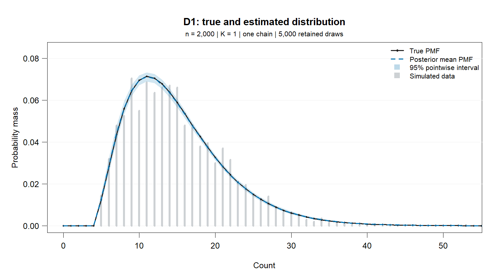
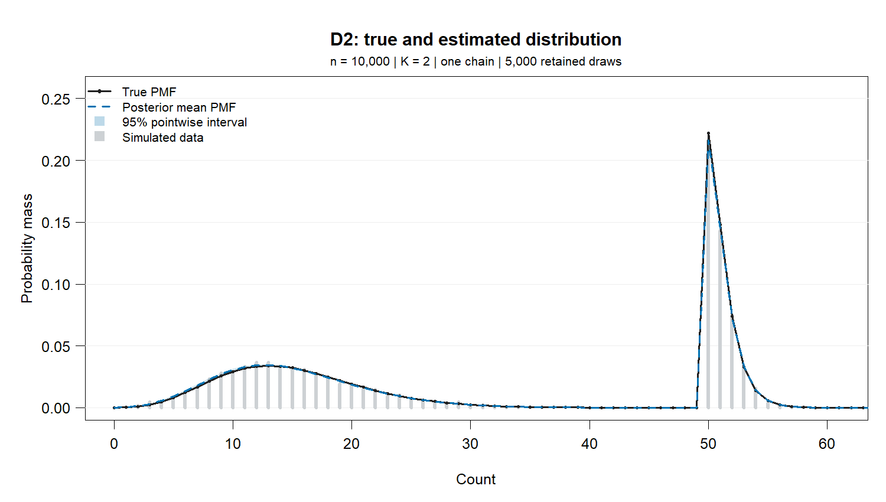
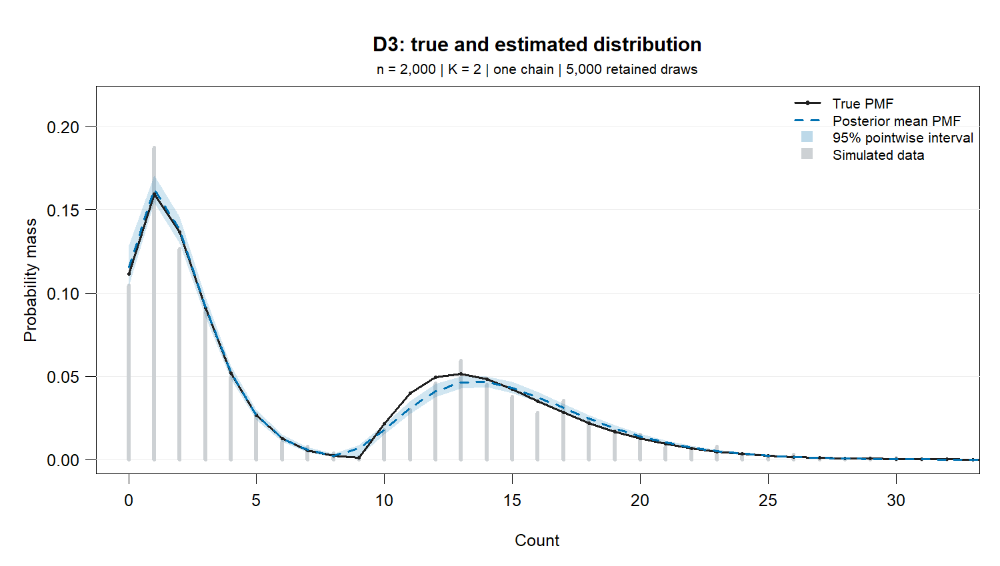

# D1-D4: single-chain simulation results

One simulated dataset and one MCMC chain per design. D3 and D4 use the same observations.

## Method

Each chain uses 10,000 iterations: 5,000 burn-in and 5,000 retained draws, without thinning. Fits use the current local shifted negative binomial sampler and its default priors. No chain was selected from multiple runs.

D1 calls the underlying sampler directly because the public mixture-object constructor rejects `K = 1`; D2-D4 use `bayes_fit`. All four use the same sampling algorithm and default prior settings (`a0 = 1`, `A0 = 200`, initial MH scale `sig = 0.1`).

The estimated distribution is the mean of the mixture PMF over all retained draws, including all six fitted components in D4. Shading gives 95% pointwise posterior intervals for the PMF, not predictive intervals for individual observations. Lines connect integer counts for readability.

Parameter estimates are posterior means, with equal-tailed 95% credible intervals. Shape and success probability are transformed in each draw before averaging: `r = 1/rtilde - 1` and `p = r/(r + mu)`. Here `mu` is the unshifted negative binomial mean; the component mean is `kappa + mu`.

For component comparisons, retain the largest-weight components (one in D1, two otherwise) and order them by `kappa + mu` in each draw. D4 extras are ranked by decreasing weight in each draw. This is a reporting convention, not evidence that exactly two components were recovered. Extras have true weight zero and undefined true shape/location parameters.

One chain and one dataset per design do not establish convergence or repeated-sampling recovery. No between-chain R-hat is available. Single-chain bulk ESS values below describe only the sampled trajectory.

## Distribution comparison

TV pools the probability above the evaluation grid into one tail bin; it is a lower bound on full-support total variation. CDF error is the maximum on the grid. Modes below belong to the true and posterior-mean PMFs, not the posterior distribution of mode counts.

| Case | n | K | True modes | Estimated modes | TV (tail pooled) | Max CDF error | Mean ESS | Log-likelihood ESS | Runtime (s) |
|---|---:|---:|---|---|---:|---:|---:|---:|---:|
| D1 | 2000 | 1 | 11 | 11 | 0.0026 | 0.0020 | 3542 | 1435 | 129.6 |
| D2 | 10000 | 2 | 13, 50 | 13, 50 | 0.0130 | 0.0108 | 3982 | 554 | 876.5 |
| D3 | 2000 | 2 | 1, 13 | 1, 14 | 0.0286 | 0.0149 | 3215 | 118 | 69.3 |
| D4 | 2000 | 6 | 1, 13 | 1, 13 | 0.0173 | 0.0106 | 4112 | 1675 | 108.9 |

D3 has the largest distribution error among these runs (TV 0.0286). The parameter tables below also show why a close distribution fit does not establish parameter recovery.

## Batch adaptation comparison

Before: joint shift-mean updates with cumulative acceptance-rate tuning. After: joint updates with batch adaptation and tuning state preserved during component sorting. Each pair uses identical observations, data and chain seeds, priors, and iteration counts. One chain per method and design cannot establish a general improvement or convergence.

Lower TV and CDF error are better; higher log-likelihood bulk ESS indicates more effective draws for that quantity. Negative TV changes indicate improvement in this run.

| Case | TV before | TV batch | TV change | CDF error before | CDF error batch | Log-likelihood ESS before | Log-likelihood ESS batch |
|---|---:|---:|---:|---:|---:|---:|---:|
| D1 | 0.0024 | 0.0026 | +0.0002 | 0.0018 | 0.0020 | 807.2 | 1435.4 |
| D3 | 0.0208 | 0.0286 | +0.0078 | 0.0120 | 0.0149 | 2.4 | 118.4 |
| D4 | 0.0174 | 0.0173 | -0.0001 | 0.0106 | 0.0106 | 1045.1 | 1674.5 |

**Not rerun with batch adaptation:** D2. Their rows in the distribution summary, plots, and parameter tables retain the previous joint-update results; they are excluded from the batch comparison above.

The previous chains and summaries are preserved in [results-before-batch.rds](results-before-batch.rds).

## D1



Data seed: `202601`. Chain seed: `31001`. PMF evaluation grid: 0-200. Estimated mass beyond the grid: 0.

Shift update: Joint shift-mean update (kappa + mu held fixed during the shift step).

Proposal adaptation: 50-iteration burn-in batches targeting 30-40% acceptance, with diminishing adjustments; tuning state follows component sorting.

| Component | Parameter | True | Estimated mean | 95% credible interval |
|---|---|---:|---:|---|
| 1 | Weight pi | 1.0000 | 1.0000 | [1.0000, 1.0000] |
| 1 | Shift kappa | 5.0000 | 5.0000 | [5.0000, 5.0000] |
| 1 | NB mean mu | 10.0000 | 9.9957 | [9.7128, 10.2931] |
| 1 | Shape r | 3.0000 | 2.9653 | [2.7249, 3.2240] |
| 1 | rtilde | 0.2500 | 0.2524 | [0.2367, 0.2685] |
| 1 | Success probability p | 0.2308 | 0.2287 | [0.2132, 0.2449] |
| 1 | Component mean kappa + mu | 15.0000 | 14.9957 | [14.7128, 15.2931] |

## D2



Data seed: `202602`. Chain seed: `31002`. PMF evaluation grid: 0-200. Estimated mass beyond the grid: 0.

Shift update: Joint shift-mean update (kappa + mu held fixed during the shift step).

**Not rerun with batch adaptation.** These are the retained results from the previous joint-update run.

| Component | Parameter | True | Estimated mean | 95% credible interval |
|---|---|---:|---:|---|
| 1 | Weight pi | 0.5000 | 0.5072 | [0.4976, 0.5168] |
| 1 | Shift kappa | 0.0000 | 0.0000 | [0.0000, 0.0000] |
| 1 | NB mean mu | 15.0000 | 14.8076 | [14.6370, 14.9765] |
| 1 | Shape r | 10.0000 | 9.4505 | [8.8624, 10.0661] |
| 1 | rtilde | 0.0909 | 0.0958 | [0.0904, 0.1014] |
| 1 | Success probability p | 0.4000 | 0.3895 | [0.3743, 0.4048] |
| 1 | Component mean kappa + mu | 15.0000 | 14.8076 | [14.6370, 14.9765] |
| 2 | Weight pi | 0.5000 | 0.4928 | [0.4832, 0.5024] |
| 2 | Shift kappa | 50.0000 | 50.0000 | [50.0000, 50.0000] |
| 2 | NB mean mu | 1.0000 | 1.0266 | [0.9925, 1.0623] |
| 2 | Shape r | 2.0000 | 1.9384 | [1.6916, 2.2202] |
| 2 | rtilde | 0.3333 | 0.3411 | [0.3105, 0.3715] |
| 2 | Success probability p | 0.6667 | 0.6530 | [0.6211, 0.6846] |
| 2 | Component mean kappa + mu | 51.0000 | 51.0266 | [50.9925, 51.0623] |

## D3



Data seed: `202603`. Chain seed: `31003`. PMF evaluation grid: 0-200. Estimated mass beyond the grid: 0.

Shift update: Joint shift-mean update (kappa + mu held fixed during the shift step).

Proposal adaptation: 50-iteration burn-in batches targeting 30-40% acceptance, with diminishing adjustments; tuning state follows component sorting.

| Component | Parameter | True | Estimated mean | 95% credible interval |
|---|---|---:|---:|---|
| 1 | Weight pi | 0.6000 | 0.6092 | [0.5881, 0.6304] |
| 1 | Shift kappa | 0.0000 | 0.0000 | [0.0000, 0.0000] |
| 1 | NB mean mu | 2.0000 | 1.9874 | [1.8941, 2.0832] |
| 1 | Shape r | 5.0000 | 4.9235 | [3.5900, 6.7358] |
| 1 | rtilde | 0.1667 | 0.1719 | [0.1293, 0.2179] |
| 1 | Success probability p | 0.7143 | 0.7086 | [0.6418, 0.7742] |
| 1 | Component mean kappa + mu | 2.0000 | 1.9874 | [1.8941, 2.0832] |
| 2 | Weight pi | 0.4000 | 0.3908 | [0.3696, 0.4119] |
| 2 | Shift kappa | 10.0000 | 9.0404 | [9.0000, 10.0000] |
| 2 | NB mean mu | 5.0000 | 6.1592 | [5.2812, 6.4465] |
| 2 | Shape r | 3.0000 | 5.5828 | [3.3172, 6.8141] |
| 2 | rtilde | 0.2500 | 0.1541 | [0.1280, 0.2316] |
| 2 | Success probability p | 0.3750 | 0.4734 | [0.3876, 0.5249] |
| 2 | Component mean kappa + mu | 15.0000 | 15.1996 | [14.9411, 15.4505] |

## D4


Data seed: `202603`. Chain seed: `31004`. PMF evaluation grid: 0-200. Estimated mass beyond the grid: 1.68e-09.

Shift update: Joint shift-mean update (kappa + mu held fixed during the shift step).

Proposal adaptation: 50-iteration burn-in batches targeting 30-40% acceptance, with diminishing adjustments; tuning state follows component sorting.

| Component | Parameter | True | Estimated mean | 95% credible interval |
|---|---|---:|---:|---|
| 1 | Weight pi | 0.6000 | 0.6107 | [0.5892, 0.6317] |
| 1 | Shift kappa | 0.0000 | 0.0000 | [0.0000, 0.0000] |
| 1 | NB mean mu | 2.0000 | 2.0109 | [1.9160, 2.1098] |
| 1 | Shape r | 5.0000 | 4.5029 | [3.4110, 6.1473] |
| 1 | rtilde | 0.1667 | 0.1843 | [0.1399, 0.2267] |
| 1 | Success probability p | 0.7143 | 0.6882 | [0.6290, 0.7540] |
| 1 | Component mean kappa + mu | 2.0000 | 2.0109 | [1.9160, 2.1098] |
| 2 | Weight pi | 0.4000 | 0.3890 | [0.3678, 0.4103] |
| 2 | Shift kappa | 10.0000 | 10.0000 | [10.0000, 10.0000] |
| 2 | NB mean mu | 5.0000 | 5.2277 | [4.9701, 5.4955] |
| 2 | Shape r | 3.0000 | 3.3639 | [2.8346, 4.0009] |
| 2 | rtilde | 0.2500 | 0.2302 | [0.2000, 0.2608] |
| 2 | Success probability p | 0.3750 | 0.3909 | [0.3494, 0.4352] |
| 2 | Component mean kappa + mu | 15.0000 | 15.2277 | [14.9701, 15.4955] |
| Extra 1 | Weight pi | 0.0000 | 0.0003 | [3.303e-100, 0.0029] |
| Extra 1 | Shift kappa | N/A | 14.9292 | [0.0000, 30.0000] |
| Extra 1 | NB mean mu | N/A | 15.2449 | [0.8337, 30.3127] |
| Extra 1 | Shape r | N/A | 63.4101 | [1.0513, 82.3617] |
| Extra 1 | rtilde | N/A | 0.2495 | [0.0120, 0.4875] |
| Extra 1 | Success probability p | N/A | 0.3052 | [0.0434, 0.9336] |
| Extra 1 | Component mean kappa + mu | N/A | 30.1741 | [6.6322, 55.1290] |
| Extra 2 | Weight pi | 0.0000 | 2.297e-06 | [3.688e-198, 1.514e-06] |
| Extra 2 | Shift kappa | N/A | 15.6556 | [0.0000, 31.0000] |
| Extra 2 | NB mean mu | N/A | 15.3777 | [0.7078, 30.1844] |
| Extra 2 | Shape r | N/A | 19.7358 | [1.0470, 78.8901] |
| Extra 2 | rtilde | N/A | 0.2519 | [0.0125, 0.4885] |
| Extra 2 | Success probability p | N/A | 0.3003 | [0.0433, 0.9523] |
| Extra 2 | Component mean kappa + mu | N/A | 31.0333 | [6.6123, 55.7418] |
| Extra 3 | Weight pi | 0.0000 | 4.624e-08 | [0.0000, 5.344e-11] |
| Extra 3 | Shift kappa | N/A | 15.4364 | [0.0000, 31.0000] |
| Extra 3 | NB mean mu | N/A | 15.4149 | [0.8102, 30.1456] |
| Extra 3 | Shape r | N/A | 16.3932 | [1.0472, 88.7353] |
| Extra 3 | rtilde | N/A | 0.2494 | [0.0111, 0.4885] |
| Extra 3 | Success probability p | N/A | 0.3065 | [0.0429, 0.9368] |
| Extra 3 | Component mean kappa + mu | N/A | 30.8513 | [5.7969, 55.3049] |
| Extra 4 | Weight pi | 0.0000 | 1.471e-09 | [0.0000, 7.559e-21] |
| Extra 4 | Shift kappa | N/A | 15.5568 | [0.0000, 31.0000] |
| Extra 4 | NB mean mu | N/A | 15.4204 | [0.8005, 30.2916] |
| Extra 4 | Shape r | N/A | 16.5053 | [1.0514, 81.2237] |
| Extra 4 | rtilde | N/A | 0.2521 | [0.0122, 0.4875] |
| Extra 4 | Success probability p | N/A | 0.3018 | [0.0434, 0.9480] |
| Extra 4 | Component mean kappa + mu | N/A | 30.9772 | [6.0487, 55.4168] |

Combined weight of the four extras: posterior mean 0.0003; 95% credible interval [3.303e-100, 0.0029]. Their individual parameter summaries describe weight-ranked slots, not persistent component identities.

## Reproduction and checks

Run from the repository root:

```r
source("JOE revision/run-designs.R")
run_designs()
```

To regenerate only the report and plots from saved chains, without running any new chains:

```r
write_report(readRDS("JOE revision/results.rds"), "JOE revision",
             baseline = readRDS("JOE revision/results-before-batch.rds"))
```

The runner saves observations, full chains, retained draws, summaries, and R session details in [results.rds](results.rds). Seeds and settings are recorded above. It checks finite draws, normalized weights, PMF non-negativity and mass, and agreement between stored and independently recomputed log-likelihoods at ten retained draws per case. These numerical checks do not certify convergence.

Report generated: 2026-11-06. Sampling session: R version 4.5.3 (2026-03-11 ucrt). BayesMultiMode 0.7.1 loaded from the local working tree.
