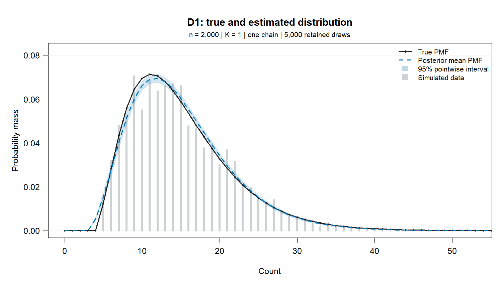
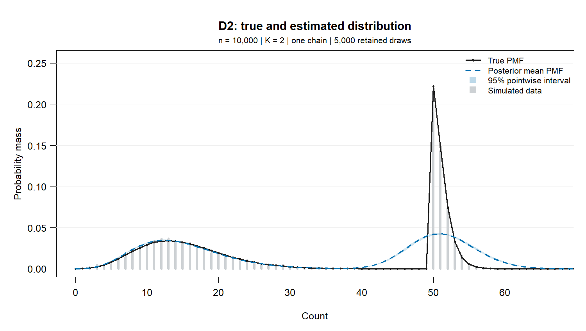
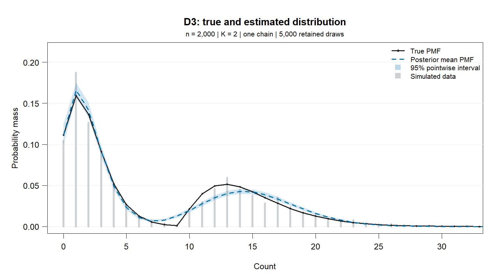

# D1-D4: single-chain simulation results

One simulated dataset and one MCMC chain per design. D3 and D4 use the same observations.

## Method

Each chain uses 10,000 iterations: 5,000 burn-in and 5,000 retained draws, without thinning. Fits use the current local shifted negative binomial sampler and its default priors. No chain was selected from multiple runs.

D1 calls the underlying sampler directly because the public mixture-object constructor rejects `K = 1`; D2-D4 use `bayes_fit`. All four use the same sampling algorithm and default prior settings (`a0 = 1`, `A0 = 200`, initial MH scale `sig = 0.1`).

The estimated distribution is the mean of the mixture PMF over all retained draws, including all six fitted components in D4. Shading gives 95% pointwise posterior intervals for the PMF, not predictive intervals for individual observations. Lines connect integer counts for readability.

Parameter estimates are posterior means, with equal-tailed 95% credible intervals. Shape and success probability are transformed in each draw before averaging: `r = 1/rtilde - 1` and `p = r/(r + mu)`. Here `mu` is the unshifted negative binomial mean; the component mean is `kappa + mu`.

For component comparisons, retain the largest-weight components (one in D1, two otherwise) and order them by `kappa + mu` in each draw. D4 extras are ranked by decreasing weight in each draw. This is a reporting convention, not evidence that exactly two components were recovered. Extras have true weight zero and undefined true shape/location parameters.

One chain and one dataset per design do not establish convergence or repeated-sampling recovery. No between-chain R-hat is available. Single-chain bulk ESS values below describe only the sampled trajectory.

## Distribution comparison

TV pools the probability above the evaluation grid into one tail bin; it is a lower bound on full-support total variation. CDF error is the maximum on the grid. Modes below belong to the true and posterior-mean PMFs, not the posterior distribution of mode counts.

| Case | n | K | True modes | Estimated modes | TV (tail pooled) | Max CDF error | Mean ESS | Log-likelihood ESS | Runtime (s) |
|---|---:|---:|---|---|---:|---:|---:|---:|---:|
| D1 | 2000 | 1 | 11 | 12 | 0.0232 | 0.0110 | 2937 | 1772 | 61.9 |
| D2 | 10000 | 2 | 13, 50 | 13, 51 | 0.3262 | 0.1839 | 9 | 1 | 346.1 |
| D3 | 2000 | 2 | 1, 13 | 1, 14 | 0.0562 | 0.0230 | 2566 | 614 | 61.6 |
| D4 | 2000 | 6 | 1, 13 | 1, 14 | 0.0285 | 0.0148 | 3808 | 45 | 105.8 |

## D1



Data seed: `202601`. Chain seed: `31001`. PMF evaluation grid: 0-200. Estimated mass beyond the grid: 0.

| Component | Parameter | True | Estimated mean | 95% credible interval |
|---|---|---:|---:|---|
| 1 | Weight pi | 1.0000 | 1.0000 | [1.0000, 1.0000] |
| 1 | Shift kappa | 5.0000 | 4.0000 | [4.0000, 4.0000] |
| 1 | NB mean mu | 10.0000 | 10.9951 | [10.7162, 11.2858] |
| 1 | Shape r | 3.0000 | 3.9426 | [3.6263, 4.2634] |
| 1 | rtilde | 0.2500 | 0.2025 | [0.1900, 0.2162] |
| 1 | Success probability p | 0.2308 | 0.2639 | [0.2476, 0.2803] |
| 1 | Component mean kappa + mu | 15.0000 | 14.9951 | [14.7162, 15.2858] |

## D2



Data seed: `202602`. Chain seed: `31002`. PMF evaluation grid: 0-200. Estimated mass beyond the grid: 7.77e-15.

| Component | Parameter | True | Estimated mean | 95% credible interval |
|---|---|---:|---:|---|
| 1 | Weight pi | 0.5000 | 0.5066 | [0.4964, 0.5164] |
| 1 | Shift kappa | 0.0000 | 1.0000 | [1.0000, 1.0000] |
| 1 | NB mean mu | 15.0000 | 13.7736 | [13.5993, 13.9482] |
| 1 | Shape r | 10.0000 | 7.8564 | [7.3658, 8.3516] |
| 1 | rtilde | 0.0909 | 0.1130 | [0.1069, 0.1195] |
| 1 | Success probability p | 0.4000 | 0.3631 | [0.3479, 0.3777] |
| 1 | Component mean kappa + mu | 15.0000 | 14.7736 | [14.5993, 14.9482] |
| 2 | Weight pi | 0.5000 | 0.4934 | [0.4836, 0.5036] |
| 2 | Shift kappa | 50.0000 | 30.0000 | [30.0000, 30.0000] |
| 2 | NB mean mu | 1.0000 | 21.3073 | [21.1566, 21.6143] |
| 2 | Shape r | 2.0000 | 113539.2718 | [47412.2682, 215555.4607] |
| 2 | rtilde | 0.3333 | 0.0000 | [0.0000, 0.0000] |
| 2 | Success probability p | 0.6667 | 0.9997 | [0.9995, 0.9999] |
| 2 | Component mean kappa + mu | 51.0000 | 51.3073 | [51.1566, 51.6143] |

## D3



Data seed: `202603`. Chain seed: `31003`. PMF evaluation grid: 0-200. Estimated mass beyond the grid: 0.

| Component | Parameter | True | Estimated mean | 95% credible interval |
|---|---|---:|---:|---|
| 1 | Weight pi | 0.6000 | 0.6002 | [0.5786, 0.6219] |
| 1 | Shift kappa | 0.0000 | 0.0000 | [0.0000, 0.0000] |
| 1 | NB mean mu | 2.0000 | 1.9093 | [1.8162, 2.0073] |
| 1 | Shape r | 5.0000 | 7.0801 | [4.5181, 11.4846] |
| 1 | rtilde | 0.1667 | 0.1294 | [0.0801, 0.1812] |
| 1 | Success probability p | 0.7143 | 0.7797 | [0.7012, 0.8584] |
| 1 | Component mean kappa + mu | 2.0000 | 1.9093 | [1.8162, 2.0073] |
| 2 | Weight pi | 0.4000 | 0.3998 | [0.3781, 0.4214] |
| 2 | Shift kappa | 10.0000 | 4.0000 | [4.0000, 4.0000] |
| 2 | NB mean mu | 5.0000 | 11.0412 | [10.7871, 11.3086] |
| 2 | Shape r | 3.0000 | 41.2898 | [26.8365, 67.8064] |
| 2 | rtilde | 0.2500 | 0.0251 | [0.0145, 0.0359] |
| 2 | Success probability p | 0.3750 | 0.7805 | [0.7071, 0.8605] |
| 2 | Component mean kappa + mu | 15.0000 | 15.0412 | [14.7871, 15.3086] |

## D4


Data seed: `202603`. Chain seed: `31004`. PMF evaluation grid: 0-200. Estimated mass beyond the grid: 1.74e-09.

| Component | Parameter | True | Estimated mean | 95% credible interval |
|---|---|---:|---:|---|
| 1 | Weight pi | 0.6000 | 0.6089 | [0.5871, 0.6303] |
| 1 | Shift kappa | 0.0000 | 0.0000 | [0.0000, 0.0000] |
| 1 | NB mean mu | 2.0000 | 1.9877 | [1.8977, 2.0881] |
| 1 | Shape r | 5.0000 | 4.9876 | [3.6724, 6.6837] |
| 1 | rtilde | 0.1667 | 0.1698 | [0.1301, 0.2140] |
| 1 | Success probability p | 0.7143 | 0.7116 | [0.6488, 0.7732] |
| 1 | Component mean kappa + mu | 2.0000 | 1.9877 | [1.8977, 2.0881] |
| 2 | Weight pi | 0.4000 | 0.3786 | [0.2312, 0.4119] |
| 2 | Shift kappa | 10.0000 | 8.9892 | [9.0000, 9.0000] |
| 2 | NB mean mu | 5.0000 | 6.1120 | [4.7179, 6.4655] |
| 2 | Shape r | 3.0000 | 8.4714 | [4.7665, 22.0476] |
| 2 | rtilde | 0.2500 | 0.1417 | [0.0434, 0.1734] |
| 2 | Success probability p | 0.3750 | 0.5037 | [0.4347, 0.8246] |
| 2 | Component mean kappa + mu | 15.0000 | 15.1012 | [13.7179, 15.4655] |
| Extra 1 | Weight pi | 0.0000 | 0.0125 | [0.0000, 0.1564] |
| Extra 1 | Shift kappa | N/A | 14.4882 | [0.0000, 30.0000] |
| Extra 1 | NB mean mu | N/A | 14.6439 | [0.7757, 30.0734] |
| Extra 1 | Shape r | N/A | 26.4659 | [1.0475, 72.1871] |
| Extra 1 | rtilde | N/A | 0.2326 | [0.0137, 0.4884] |
| Extra 1 | Success probability p | N/A | 0.3443 | [0.0443, 0.9385] |
| Extra 1 | Component mean kappa + mu | N/A | 29.1321 | [6.7365, 54.9811] |
| Extra 2 | Weight pi | 0.0000 | 0.0000 | [0.0000, 0.0001] |
| Extra 2 | Shift kappa | N/A | 15.3122 | [0.0000, 31.0000] |
| Extra 2 | NB mean mu | N/A | 15.4045 | [0.8268, 30.1131] |
| Extra 2 | Shape r | N/A | 26.3053 | [1.0678, 84.5592] |
| Extra 2 | rtilde | N/A | 0.2514 | [0.0117, 0.4836] |
| Extra 2 | Success probability p | N/A | 0.3000 | [0.0438, 0.9353] |
| Extra 2 | Component mean kappa + mu | N/A | 30.7167 | [6.3988, 54.8878] |
| Extra 3 | Weight pi | 0.0000 | 0.0000 | [0.0000, 0.0000] |
| Extra 3 | Shift kappa | N/A | 15.3746 | [0.0000, 31.0000] |
| Extra 3 | NB mean mu | N/A | 15.4786 | [0.7498, 30.3579] |
| Extra 3 | Shape r | N/A | 14.0417 | [1.0531, 77.1255] |
| Extra 3 | rtilde | N/A | 0.2526 | [0.0128, 0.4871] |
| Extra 3 | Success probability p | N/A | 0.2998 | [0.0424, 0.9367] |
| Extra 3 | Component mean kappa + mu | N/A | 30.8532 | [6.7123, 55.2486] |
| Extra 4 | Weight pi | 0.0000 | 0.0000 | [0.0000, 0.0000] |
| Extra 4 | Shift kappa | N/A | 15.6248 | [0.0000, 31.0000] |
| Extra 4 | NB mean mu | N/A | 15.5665 | [0.8027, 30.2876] |
| Extra 4 | Shape r | N/A | 14.2351 | [1.0470, 68.6415] |
| Extra 4 | rtilde | N/A | 0.2518 | [0.0144, 0.4885] |
| Extra 4 | Success probability p | N/A | 0.3007 | [0.0436, 0.9292] |
| Extra 4 | Component mean kappa + mu | N/A | 31.1913 | [6.7524, 55.3199] |

Combined weight of the four extras: posterior mean 0.01248; 95% credible interval [0.00000, 0.15643]. Their individual parameter summaries describe weight-ranked slots, not persistent component identities.

## Reproduction and checks

Run from the repository root:

```r
source("JOE revision/run-designs.R")
run_designs()
```

The runner saves observations, full chains, retained draws, summaries, and R session details in [results.rds](results.rds). Seeds and settings are recorded above. It checks finite draws, normalized weights, PMF non-negativity and mass, and agreement between stored and independently recomputed log-likelihoods at ten retained draws per case. These numerical checks do not certify convergence.

Report generated: 2026-11-06. R version 4.5.3 (2026-03-11 ucrt). BayesMultiMode 0.7.1 loaded from the local working tree, including uncommitted sampler changes.
