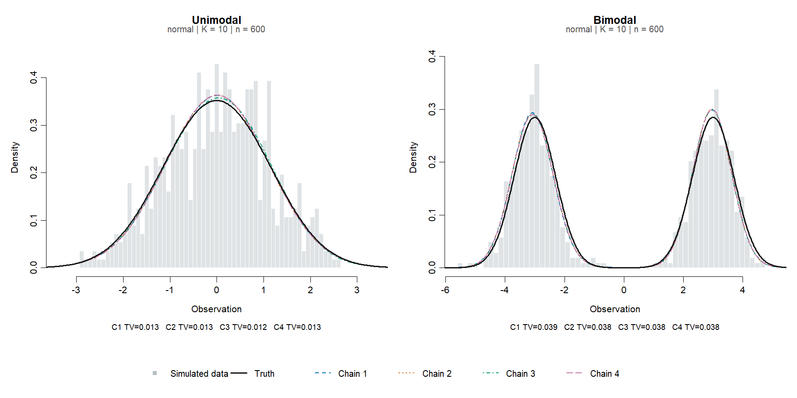
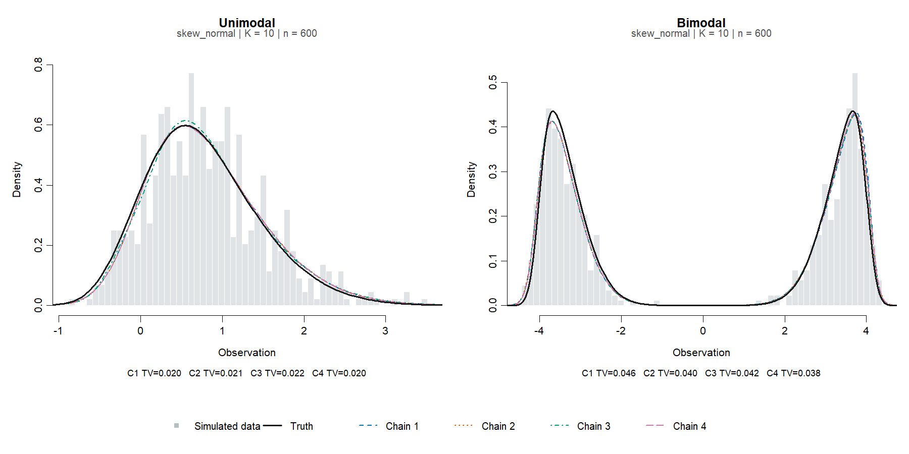
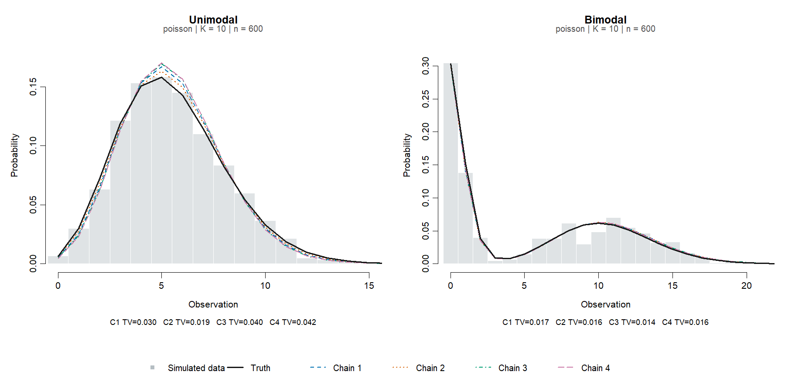
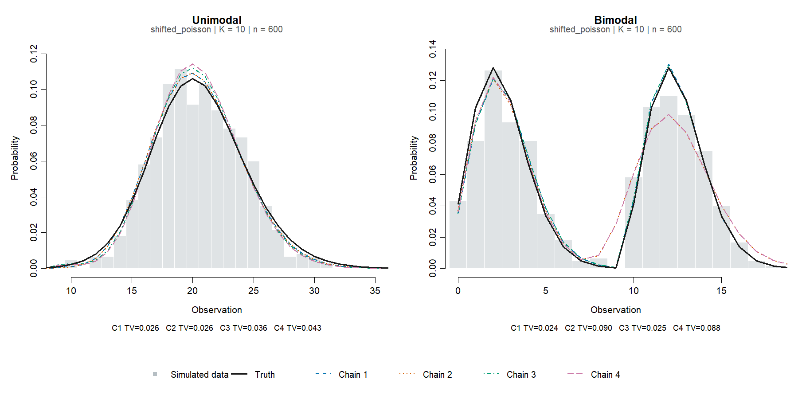
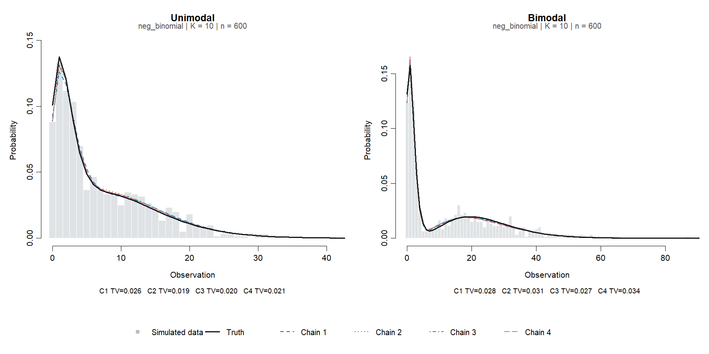
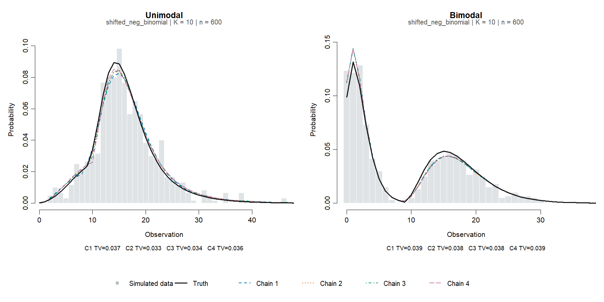

# Estimation simulations

Each method has a unimodal and a bimodal experiment. Each generates 600 IID
observations from an equal-weight, two-component mixture, then fits four
independently seeded chains to the same data using `bayes_fit(K = 10)`.
Priors, iterations (2,000), and burn-in (1,000) use package defaults; only
progress printing is disabled.

| Method (`dist`) | Unimodal truth | Bimodal truth |
| --- | --- | --- |
| `normal` | Means (-0.5, 0.5), SD 1 | Means (-3, 3), SD 0.7 |
| `skew_normal` | Locations (-0.25, 0.25), scale 1, shapes (3, 3) | Locations (-4, 4), scale 0.8, shapes (4, -4) |
| `poisson` | Rates (4.5, 6.5) | Rates (0.5, 10.5) |
| `shifted_poisson` | Rates (20.5, 10.5), shifts (0, 10) | Rates (2.5, 2.5), shifts (0, 10) |
| `neg_binomial` | Means (2, 12), size 4 | Means (1.5, 24), size 6 |
| `shifted_neg_binomial` | Means (16, 6), size 6, shifts (0, 10) | Means (2, 7.5), size 4, shifts (0, 10) |

Negative-binomial means are unshifted. In the shifted unimodal cases,
post-shift means coincide despite the 10-unit separation. Reference checks
verify mode counts, normalization, plateau handling, and sample CDFs.

## Data and fits

Left: unimodal; right: bimodal. Grey bars show simulated data, black lines the
truth, and coloured lines each chain's posterior-mean density. TV is
total-variation error. Failed samplers are labelled "no fit"; no curve is
substituted. A close density fit does not imply mode recovery or convergence.








## Recovery checks

Every chain must pass independently: approximate total-variation distance
below 0.15 and maximum CDF error below 0.10. Grids cover [-12, 12] in steps of
0.025 for continuous densities and integers 0:200 for PMFs. A residual-mass bin
accounts for tails; each draw must retain at least 99% mass on the grid.
Tests also check weights and recompute likelihoods.

On 100 retained draws, `bayes_mode()` must recover the true mode count in over
70% and all locations jointly in over 60%, within 0.5 for continuous data or
two integers for counts. Mode recovery uses the default observed-data range,
excluding peripheral modes outside that range. The wider grids remain in use
for density/CDF checks. Component labels are never matched.

## Running

From the repository root:

```r
pkgload::load_all(".")
Sys.setenv(BAYESMULTIMODE_RUN_SIMULATION = "true",
					 BAYESMULTIMODE_RUN_CONVERGENCE = "false",
					 BAYESMULTIMODE_SIMULATION_PLOT_DIR =
						 file.path(getwd(), "tests/testthat/simulation/figures"))
testthat::set_max_fails(Inf)
testthat::test_dir("tests/testthat", filter = "simulation")
```

Set `BAYESMULTIMODE_SIMULATION_METHOD` to a `dist` value to regenerate one pair;
unset it for all methods. Without the simulation flag, only reference checks
run. R-hat/ESS tests remain disabled unless the convergence flag is `"true"`.
They require mixture-level R-hat below 1.05 and bulk/tail ESS above 400.

These regressions do not establish general posterior validity. Sampler errors
remain test failures.
